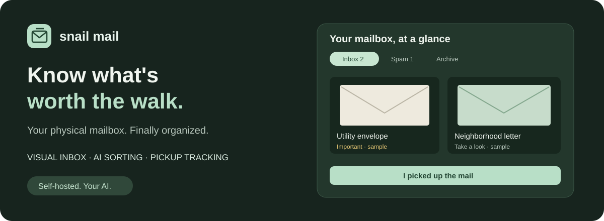
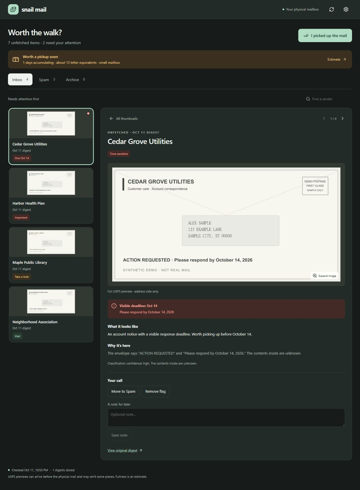
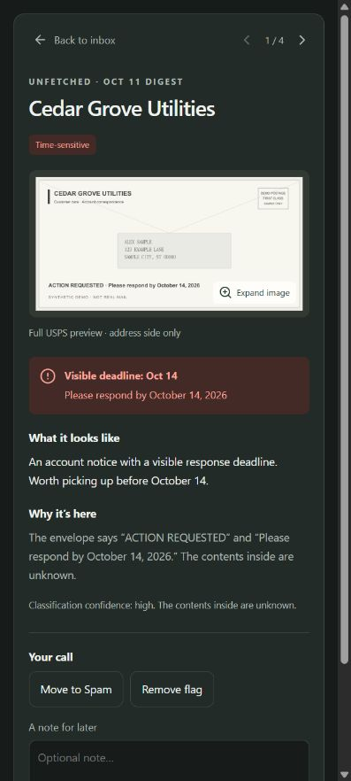
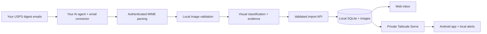

# Snail Mail — an AI inbox for your physical mailbox

**Know what's worth the walk.** Turn USPS Informed Delivery emails into a visual inbox of mail you haven't picked up yet.



Snail Mail is a **self-hosted USPS Informed Delivery dashboard** with thumbnail previews, AI-assisted junk mail sorting, important-mail flags, mailbox fullness estimates, and an Android companion app. Bring your own Codex or another AI agent to read and classify your digests. Keep the inbox, images, and pickup history on your own computer.

Built for the mailbox you forget to check because most of it is advertising.

[Get started](#get-started) · [Connect your AI](docs/INGESTION.md) · [Android and tray setup](docs/SETUP.md) · [Privacy](SECURITY.md)

## A physical-mail inbox that remembers for you

- **See your mail first.** Browse envelope scans and promotional previews as thumbnails. Open a full image in the desktop split reader or a phone-friendly detail view.
- **Keep the useful stuff visible.** Separate Inbox and Spam tabs, evidence-backed importance flags, and visible-deadline alerts help you decide what deserves attention. Correct the AI whenever it gets something wrong.
- **Know when the mailbox may be filling up.** A configurable estimate counts both useful mail and spam, accounting for bulk and days since pickup.
- **Clear everything with one pickup.** Click **I picked up the mail** to archive the accumulated inbox. New mail starts with the next day's digest. Undo is available.
- **Don't count a digital preview four times.** Recognized USPS saturation campaign repeats become one expected mailing, with every source appearance preserved and delivery explicitly unconfirmed.
- **Get local Android notifications.** Optional background checks over Tailscale flag important mail, approaching deadlines, stronger fullness warnings, or failed checks. No Firebase account or push relay is required.
- **Keep Windows quiet.** An optional system tray server starts at sign-in, opens from a desktop shortcut, and runs without a console window. Toggle automatic startup directly from the tray menu.
- **Choose what comes first.** Sort Inbox, Spam, and Archive by recency or importance. The website and Android app remember your choice.
- **See package status at a glance.** Colored thumbnails distinguish awaiting USPS, transit, delivery day, confirmed delivery, and delivery issues. Your agent can check USPS tracking during scheduled ingestion; each card shows when its status was checked.

## Screenshots

Actual application screens with **synthetic demo mail**. All names, addresses, and mail images below are fictional. The mobile screenshot shows the responsive web interface shared with the Android app.

| Desktop: thumbnails and full-image reader | Mobile: focused detail view |
| --- | --- |
| [](docs/assets/desktop-reader.jpg) | [](docs/assets/mobile-detail.jpg) |

Click either screenshot to view it at full size.

## Get started

You need **Node.js 24+**, npm, USPS Informed Delivery digest emails, and an AI tool that can read your authorized Gmail messages, inspect images, and run local commands. Gmail/AI access is **not** included in this repository.

```sh
git clone https://github.com/arusaha/snail-mail.git
cd snail-mail
npm ci
npm run setup
npm run build
npm start
```

Open **http://127.0.0.1:4318**. Setup creates an ignored `data/config.json` using today's date and your computer's timezone. The inbox starts empty until you connect an ingestion agent.

To backfill from a different date, supply it on the first setup:

```sh
npm run setup -- --start-date 2026-01-01 --timezone America/New_York
```

Setup never overwrites an existing configuration. See [config.example.json](config.example.json) and [the setup guide](docs/SETUP.md) for private phone access, Android builds, startup, backups, and platform requirements. Set your timezone and start date **before importing mail**; changing pickup calendar semantics later requires care.

## Bring your own Codex or other AI

The app does not contain a model API client, a Gmail OAuth app, or an always-running email scraper. Your chosen agent handles email access and visual classification; the local application validates and stores its results.

**With Codex:** open this checkout, connect your own Gmail account, and ask it to use the included [snail-mail-ingestion skill](.agents/skills/snail-mail-ingestion/SKILL.md). Run one check manually, inspect the results, then schedule the same workflow once or twice a day. The local computer, app, and necessary connector must be available at run time.

**With another AI:** give it [the ingestion guide](docs/INGESTION.md) and the skill instructions. It needs an authorized email/MIME attachment tool, image understanding, local filesystem access, and command execution. Agents without Gmail attachment support need a small adapter or a manual export of the original email and images. Text-only email summaries are insufficient.

Try this starter request:

> Read `.agents/skills/snail-mail-ingestion/SKILL.md` and `docs/INGESTION.md`. Use my connected Gmail to ingest only authenticated USPS Informed Delivery daily digests from my configured start date. Inspect the images, explain classifications, import through the local API, and verify persisted results. Do not modify Gmail. Report any incomplete import. Keep future routine checks quiet unless important mail, a stronger fullness warning, or a meaningful failure needs my attention.

The [detailed guide](docs/INGESTION.md) includes normalized MIME examples, classification JSON, connector-independent image ingestion, scheduling prompts, and failure recovery. No separate OpenAI API key is required when your existing agent supplies the model and tools; your provider's plan, limits, and privacy terms still apply.

## How it works



React + TypeScript power the interface. Express and Node's built-in SQLite support the backend. Sharp validates images and creates thumbnails. Capacitor and Android WorkManager provide the phone app. An optional Windows Forms tray host manages the local Node process.

## What the estimates mean

AI supplies a category, priority, visible evidence, and an estimated size of 1–5 letter equivalents per item. **The fullness calculation itself is deterministic.** Defaults suggest pickup at 12 letter equivalents or 7 days, escalating at 20 equivalents or 14 days. Adjust them for your mailbox in Settings.

USPS previews may precede delivery or omit pieces. A campaign preview is not delivery confirmation. Each unfetched package explicitly confirmed by USPS as delivered in/at the mailbox adds a conservative **5 letter equivalents**; its age starts on the delivery date. Tracking does not provide dimensions. Expected packages, porch deliveries, parcel lockers, and unknown delivery locations do not count as mailbox occupancy. Pickup clears the package contribution, and Undo restores it. Important flags are an aid to review, not a guarantee that a deadline or important letter will be detected.

Pickup uses your configured calendar timezone. Late imports for a collected date stay archived. A repeated saturation campaign follows its first appearance date, so its later previews stay archived after pickup. A new campaign ID starts a new expected mailing. Ordinary matching artwork alone does not prove that physical mail is duplicated.

## Privacy and access

Mail storage is local; inference may send mail content to **your chosen AI provider**. The server binds to loopback. Remote access is designed for **Tailscale Serve**, with HTTPS and a check of your Tailscale login identity. Do not enable public Funnel for this app.

This is a **single-user app for a trusted computer**, not a hardened multi-user mail service. Localhost has no separate login. SQLite, attachments, and local credentials are not encrypted by the app; protect your OS account, device, filesystem permissions, and backups. Read [SECURITY.md](SECURITY.md) before exposing or sharing an installation.

This repository contains application source and synthetic examples only. Your `data/` folder, email contents, attachment URLs, credentials, signing keys, generated website, and personal APK builds are excluded from Git. Build your own APK with your private server address and signing key.

## Development

```sh
npm test
npm run build
# With the backend running in another terminal:
npm run dev
```

Tests cover source validation, import reconciliation, campaign deduplication, persistent corrections, pickup/Undo, calendar boundaries, access controls, notifications, and tray lifecycle. The native tray test runs on Windows when its executable has been built. Android setup and native tests are documented [here](docs/SETUP.md#android).

Contributions are welcome—especially sanitized USPS template fixtures, accessibility improvements, and email connector adapters. Never include real addresses, mail scans, tracking numbers, tokens, or private hostnames in an issue or pull request.

**MIT licensed.** An independent project; not affiliated with USPS, OpenAI, Google, or Tailscale. USPS Informed Delivery and other product names belong to their respective owners.
